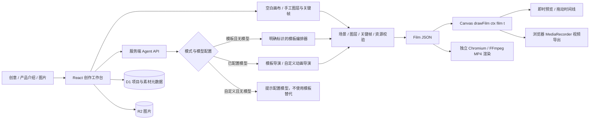

# 映动 MotionLab 架构与交付边界

MotionLab 是面向中文创作者的 coding-to-video MVP，包含模板创作与独立的自定义创作。模板适合快速编排产品短片；自定义模式可从空白画布手工创作，也可由模型生成专属图层、构图与关键帧。两种模式都支持预览、编辑、保存和视频导出，不运行用户或模型提供的任意 JavaScript。

源码托管于 GitHub，产品继续在本地运行。下文的 Cloudflare / Sites 描述为项目所采用的运行时与接口设计；本地开发使用模拟登录及本地 D1/R2 存储，不表示已有公开或私有在线服务。

## 实际链路

- **应用层：** React + TypeScript，采用 Vinext / Vite 构建，服务端使用 Cloudflare Workers API。项目保留 Sites 登录与访问控制集成，本地开发通过配套模拟登录运行。
- **创作契约：** `lib/motion/types.ts` 定义 Film、Scene、图层和关键帧。`creationMode` 区分 `template` 与 `custom`；旧模板项目无需迁移。模板为 3–8 幕，自定义为 1–12 幕，不能在同一作品中混用两类布局。
- **自定义场景图：** 每幕使用 `layout: "custom"` 和独立的 `composition`，包含背景及有序图层。图层支持 text、rect、ellipse、line、polygon、image；位置和尺寸为画布比例，关键帧时间为场景内秒数。`custom-renderer.ts` 直接绘制这些图层，跳过全部模板装饰。
- **编辑器：** `CustomPanel.tsx` 提供图层增删、排序、复制、几何与颜色编辑、关键帧记录/跳转和动画预设。`custom.ts` 提供真正空白的初始场景，以及保留每幕 0.5 秒下限的时长重排；调整场景时长会同步缩放关键帧。
- **Agent：** `lib/motion/planner.ts` 负责模式分流、结构校验和模型输出转换。自定义模式使用独立导演提示词，允许模型自由决定场景数量、元素层级、构图与动画，不调用固定模板布局。缺少模型配置时，自定义 AI 请求明确报错，手工画布仍可使用。
- **渲染契约：** 模板和自定义均通过 `drawFilm(context, film, time)` 统一进入确定性渲染。预览、浏览器导出和 CLI 复用同一逻辑；CLI 用 esbuild 打包完整依赖图，避免独立编译遗漏自定义模块。
- **导出：** `lib/motion/export.ts` 使用 Canvas captureStream 和 MediaRecorder。实际浏览器支持 MP4 时提供 MP4，否则提供 WebM，文件扩展名与实际容器一致。背景节拍通过 Web Audio 原创合成，不使用参考项目音乐。
- **持久化：** D1 存储完整 Film JSON 及图片元数据；R2 存储图片二进制，自定义数据无需额外数据库迁移。当前运行时保存在本地 `.wrangler/state`；品牌偏好保存在浏览器 localStorage。

## 自定义内容约束

服务端同时校验图层类型、十六进制颜色、有限数值范围、顶点数量及时间线。关键帧必须按时间严格递增、不重复且位于所属场景内；允许动画位置暂时超出画布，但最终画面按画布裁切。未知代码与外部资源字段不会进入有效项目。

| 范围 | 上限 |
| --- | --- |
| 自定义场景 | 12 幕，每幕至少 0.5 秒 |
| 图层 | 每幕 40 层，每部作品 240 层 |
| 关键帧 | 每层 24 个，每部作品 2,000 个 |
| 多边形 | 3–32 个顶点 |
| 文字图层 | 600 字（手工编辑面板限制为 500 字） |
| Agent / 项目保存请求体 | 400,000 字节 |

图片图层统一引用已有的项目级 `assetUrl`，不接受任意网络 URL；当前同一作品的所有图片图层使用同一份上传素材。浏览器和服务端均检查资源数量，避免继续编辑后才发现项目无法保存。

## 服务接口

| 接口 | 用途 |
| --- | --- |
| `GET /api/status` | 返回是否配置模型、当前模式及存储可用性，不返回密钥 |
| `POST /api/agent` | 接收创意或现有 Film 与修改指令，返回 Film、真实模式、说明及编排决策 |
| `GET /api/projects` | 读取当前用户最近 200 个项目 |
| `POST /api/projects` | 验证并保存项目，拒绝较旧版本覆盖较新版本 |
| `DELETE /api/projects/:id` | 删除当前用户的项目 |
| `GET /api/assets` | 读取当前用户最近 100 个素材 |
| `POST /api/assets` | 上传 PNG / JPEG / WebP，最大 8 MB |
| `GET /api/assets/:id` | 经身份与归属检查后读取图片 |
| `DELETE /api/assets/:id` | 删除当前用户未被项目引用的素材 |

所有接口需要 Sites 身份。项目和素材的 D1 主键为 `(user_id, id)`；查询、保存与删除均带当前用户条件。R2 对象按用户前缀分区，浏览器仅通过鉴权 API 读取。保存及 Agent 修改都会验证引用素材属于当前用户。写接口拒绝显式跨站请求；上传校验实际文件签名，不接收 SVG。模型只能返回受控的场景 JSON。

保存保留规范化的客户端 `updatedAt`，通过原子条件 upsert 防止同一设备的旧请求后到达时覆盖新内容；同版本相同内容允许幂等重试，过期保存返回 409。该策略不等同于多人协作版本控制，生产环境应改用服务端 revision / ETag 与显式冲突解决。

## 模型接入

服务端配置三个变量：

| 变量 | 含义 |
| --- | --- |
| `MODEL_API_KEY` | 模型服务密钥 |
| `MODEL_BASE_URL` | HTTPS API 基址，通常以 `/v1` 结尾 |
| `MODEL_NAME` | 服务商支持的模型标识 |

服务端在基址后追加 `/chat/completions`，使用 Bearer 认证，发送 system/user messages；读取 `choices[0].message.content` 内的 JSON。模板请求超时为 45 秒，输出预算为 3,000 tokens；自定义请求超时为 90 秒，输出预算为 12,000 tokens。不同供应商的兼容程度不同，实际接入前需验证参数、返回格式、费用与创作质量。密钥仅保留在服务端运行时变量中，不放入浏览器代码或 Git。

本地开发把变量放入被 Git 忽略的 `.dev.vars`，修改后重启开发服务。缺少任意一个变量时，模板请求使用模板编排；自定义 AI 请求返回明确的配置提示，不回退到模板。空白画布无需模型。模型连接失败时报告错误，不伪装成已完成生成。本地已接入火山方舟 `kimi-k3-1-pro-261024`，实际自定义生成已通过。请求不固定 temperature，避免与只接受默认值的模型冲突。

## 当前已交付与限制

已交付模板与自定义两条创作流程、素材上传、自由图层和关键帧编辑、场景增删排序、画幅与时长调整、预览播放与拖动、项目保存/复制/删除、项目 JSON 下载、浏览器视频导出与独立 MP4 渲染。

43 项测试已通过，包含模板兼容、自定义校验、动画确定性、时长下限与关键帧重排、资源上限、数据隔离和保存冲突。本地浏览器已验证自定义创建、编辑、保存、关键帧跳转及导出完成后弹窗关闭；尚未读取浏览器实际下载文件做编码检查。自定义 CLI 成片已通过 ffprobe 验证：5 秒、1280×720、30 fps、150 帧、H.264 视频和 AAC 音频。另已通过平台 API 完成该 Kimi 模型的真实自定义生成，返回 1 个场景、2 个图层、6 个关键帧，并通过结构校验；不代表所有供应商和模型均已验收。

以下为明确的 MVP 边界：

- 未接入真实模型密钥时，可用模板规则编排或自定义手工画布；AI 自定义生成需要模型配置，已验证上述 Kimi 模型的一次真实生成；尚缺大规模质量与稳定性评估。
- 不抓取用户输入的网址；需要粘贴产品介绍。未实现任意代码生成、代码沙箱、网页自动截图或无限风格生成。
- 浏览器实时编码依赖设备性能和浏览器能力，导出时须保持页面在前台。已交付独立 Chromium / FFmpeg 离线 MP4 渲染脚本，支持 30/60 fps，但尚未连接托管任务队列，也未实现运动模糊或统一编码质量保证。
- 没有支付、套餐额度、并发限制、模型调用限流、内容治理流程或完整运营后台。当前仅本地交付，没有上线部署。
- 自定义能力限于已实现的六类图层和几何属性关键帧；没有任意代码沙箱、逐字符文字动画、复杂路径编辑或独立的每层素材库。图层位置通过属性面板编辑，尚无直接拖拽画布的选择与变换工具。
- 素材页面暂未提供删除入口（API 已支持删除未被引用的素材），尚无生命周期清理、自动压缩和图片像素尺寸限制；列表采用固定上限，未实现分页。
- 暂无旁白、语音合成、音乐素材库、字幕识别、多人同时编辑、历史版本云端恢复和自动视觉质检。
- 缺少正式 SLA、审计日志、用量告警、数据备份恢复演练和多供应商持续验收。

公开商业运营前，优先补齐用户/项目配额、模型与上传限流、服务端 revision、导出队列和状态恢复、计费、素材生命周期、监控告警及隐私与内容治理。独立渲染服务应继续消费同一 Film 契约，避免预览与成片出现两套逻辑。

## 参考项目与许可

- [whaleyxbt/claude-motion](https://github.com/whaleyxbt/claude-motion)：参考统一时间线、纯时间函数、代码动效和分镜审查理念。仓库采用 MIT；实际复制其源码时应保留版权与许可证。
- [AbubakrChan/product-launch-motion](https://github.com/AbubakrChan/product-launch-motion)：参考连续形变、闭式弹簧、音乐节拍与逐帧渲染理念。技能和参考文档为 MIT，其 [NOTICE](https://github.com/AbubakrChan/product-launch-motion/blob/main/NOTICE) 明确排除示例成片及相关素材的复用许可。

本项目的示例品牌、画面、Canvas 动效与合成音轨为本次原创实现，没有将参考仓库的示例视频、截图、第三方音乐或字体当作产品模板分发。
